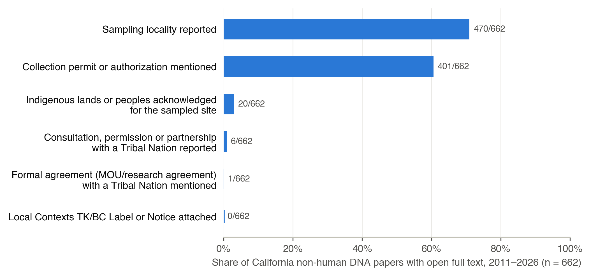
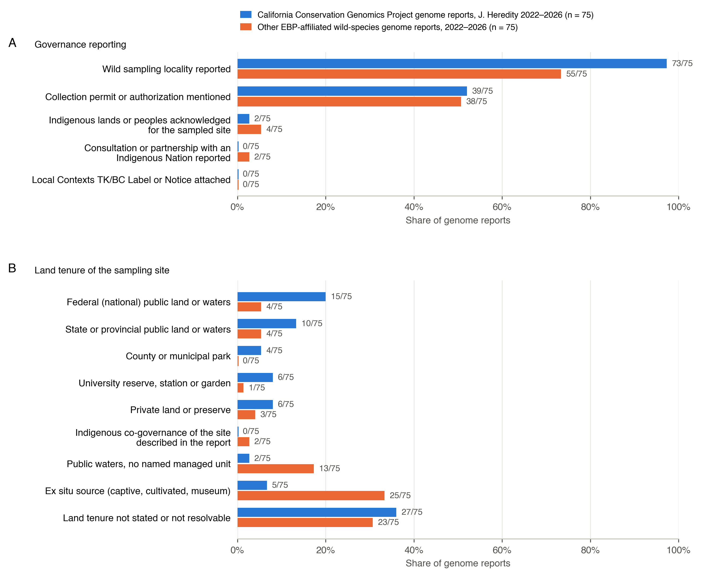

# Genomic data governance audits

Two full-text audits of how published genomic research on non-human species documents Indigenous
rights and interests: where the sample came from, under what authority it was taken, whether the
Indigenous lands or peoples of the site are named, whether any consultation, permission or agreement
with a Tribal Nation is reported, and whether a Local Contexts Traditional Knowledge or Biocultural
Label or Notice is attached to the data. Both audits were built for a Perspective on Indigenous data
governance in biodiversity genomics; they are released so that every number can be checked.

The two audits answer different questions and are reported separately.

| | Audit 1 | Audit 2 |
|---|---|---|
| Question | How does the California non-human DNA literature as a whole document Tribal rights? | How do reference-genome reports (the EBP-era "accession number" genre) document them? |
| Sample | Every open-full-text paper in Europe PMC, 2011–2026, with "California" + DNA methods + ecology in title/abstract, after a title screen | Every CCGP genome report in *J. Heredity* with open full text, plus other EBP-affiliated wild-species genome reports, 2022–2026 |
| n scored | 662 | 75 (CCGP) + 75 (other) |
| Folder | [`ca_dna_tribal_audit/`](ca_dna_tribal_audit/) | [`genome_report_audit/`](genome_report_audit/) |
| Write-up | [`ca_dna_tribal_audit/results/AUDIT_SUMMARY.md`](ca_dna_tribal_audit/results/AUDIT_SUMMARY.md) | [`genome_report_audit/results/AUDIT_SUMMARY.md`](genome_report_audit/results/AUDIT_SUMMARY.md) |

## Finding 1 — California non-human DNA research, 2011–2026 (n = 662)



| Criterion | n | % |
|---|---|---|
| Sampling locality reported | 470 | 71 |
| Collection permit or authorization mentioned | 401 | 61 |
| Indigenous lands or peoples acknowledged for the sampled site | 20 | 3.0 |
| Consultation, permission or partnership with a Tribal Nation reported | 6 | 0.9 |
| Formal agreement (MOU / research agreement) with a Tribal Nation mentioned | 1 | 0.2 |
| Local Contexts TK/BC Label or Notice attached | 0 | 0 |

Permits are routine; Tribal authority is nearly absent from the record. Land acknowledgements are a
recent practice (0 of 146 papers in 2011–2016; 11 of 193 in 2024–2026) while reported consultation or
partnership shows no trend (0, 3, 0, 3 across four periods). Only four papers in fifteen years report
consultation or partnership with a California Tribal Nation about the sampling or the data. Ten papers
collected tissue under a Memorandum of Understanding with the California Department of Fish and
Wildlife, so the MOU is already the working instrument for samples, with a state agency as counterparty.

Flow: 2,720 population papers → 1,096 with Europe PMC full text → 910 retrieved → 248 excluded by
title screen (human/clinical, laboratory, agricultural, software/review, sampling outside California,
built environment) → 662 scored. Every automated hit on the Indigenous-lands, consultation,
agreement and Local Contexts criteria (142 papers) was read and classified by hand; the verdicts are
in [`ca_dna_tribal_audit/results/adjudications.csv`](ca_dna_tribal_audit/results/adjudications.csv) and the
verified positives in [`positives_list.md`](ca_dna_tribal_audit/results/positives_list.md).

## Finding 2 — Reference-genome reports, 2022–2026 (n = 75 CCGP + 75 other EBP-affiliated)



| Criterion | CCGP (n = 75) | Other EBP-affiliated (n = 75) |
|---|---|---|
| Wild sampling locality reported (hand read) | 73 | 55 |
| Collection permit or authorization mentioned | 39 | 38 |
| Indigenous lands or peoples acknowledged for the sampled site | 2 | 4 |
| Consultation or partnership with an Indigenous Nation reported | 0 | 2 |
| Local Contexts TK/BC Label or Notice attached | 0 | 0 |
| Deposited in an open repository | 75 | 75 |

The CCGP set is every California Conservation Genomics Project genome report in *Journal of Heredity*
that Europe PMC indexes with open full text (a paywalled report that does not name the project in its
abstract would be missed), not a sample. Two CCGP reports acknowledge Indigenous lands
(one names the Chumash and Gabrielino-Tongva; one is generic); none reports consultation; none carries
a Local Contexts Label. The only two genome reports in either set that document consultation or
partnership are from Aotearoa (iwi consultation, Hector's and Māui dolphin) and Nunavut (Inuit
harvesters, beluga), jurisdictions with Treaty or land-claims frameworks. Details and the 36 hand
verdicts: [`genome_report_audit/results/`](genome_report_audit/results/).

**Land tenure of the sampling site (panel B).** Every included report was read by hand and the site
of the sequenced individual's wild collection classified by who holds the land or waters
([`land_type_adjudications.csv`](genome_report_audit/results/land_type_adjudications.csv), one row per
report with the site, the basis of the call and a note).

| Land tenure of the sampling site | CCGP (n = 75) | Other EBP-affiliated (n = 75) |
|---|---|---|
| Federal (national) public land or waters | 15 | 4 |
| State or provincial public land or waters | 10 | 4 |
| County or municipal park | 4 | 0 |
| University reserve, station or garden | 6 | 1 |
| Private land or preserve | 6 | 3 |
| Indigenous co-governance of the site described in the report | 0 | 2 |
| Public waters, no named managed unit | 2 | 13 |
| Ex situ source (captive, cultivated, museum) | 5 | 25 |
| Land tenure not stated or not resolvable | 27 | 23 |

Half of the CCGP genomes (37/75) come from public land, public waters or university reserves, and
not one of those reports names the Nation whose territory the unit sits on. A call is marked *stated*
when the report itself names the managing unit or owner (national park, wildlife area, UC reserve,
private residence), *inferred* when it names a site whose manager is public record but is not given in
the report (Cow Mountain = BLM, McClures Beach = Point Reyes National Seashore), and *none* otherwise.
California marine and intertidal points were tested against the CDFW marine protected area boundaries
(BIOS ds582, point-in-polygon); two Pacific Grove sites fall inside state MPAs and are classed as state
waters, the rest fall outside and stay "public waters, no named unit". The "Indigenous co-governance"
row is not an independent tenure finding: the two reports in it (Nunavut land-claim waters, Aotearoa
coastal waters under iwi rangatiratanga) are placed there because the reports themselves describe that
authority, and they are the same two that document consultation. The locality criterion in panel A is
now the hand read from the same sheet, because the regex used in the first release missed plain town
names (Húsavík, Kunming, Blanes) and counted zoos; the automated count is kept in `scores_final.csv`
as `location_reported_auto`. Two papers included in the first release were removed on re-reading
(PMC9946810, a software paper; PMC12921467, a grafted carob cultivar, excluded under the cultivar rule),
so the other-EBP stratum is 75, not 77. All land-tenure calls were made by a single coder in one pass;
24 are inferred rather than stated.

## Method, shared by both audits

1. **Define the population with a Europe PMC query** and fetch every record (`fetch_population.sh`,
   or the saved `data/*_lite.json`).
2. **Download full-text JATS XML** from Europe PMC for every PMCID (`fetch_fulltext_parallel.sh`).
   The XML is not redistributed here; the scripts re-fetch it in minutes.
3. **Automated screen** (`score_*.py`): regexes over the biological-materials/methods text for
   locality and permits, and over the whole paper (reference list stripped) for Indigenous lands and
   peoples (including a 56-tribe California name dictionary), consultation/permission/CARE terms,
   MOU/agreement terms, and Local Contexts terms. Every flag is written with its matching snippets.
4. **Hand verification** of every automated hit on the governance criteria, recorded with a category
   and reason in `results/adjudications.csv`. Place names (Shoshone, California; Haida Gwaii), the
   taxonomic rank "Tribe", author affiliations, Nagoya compliance boilerplate and "consultant" roles
   are the common false positives.
5. **Inclusion screen** recorded in `results/exclusions.csv` with a reason per paper.
6. **Finalize** (`finalize_and_plot*.py`): merge, write `scores_final.csv`, `summary_final.json`
   and the figure.

To reproduce Audit 1:

```bash
cd ca_dna_tribal_audit
bash scripts/fetch_population.sh data/population_lite.json
bash scripts/fetch_fulltext_parallel.sh data/epmc_fulltext data/population_lite.json
python3 scripts/score_ca_dna.py data/epmc_fulltext data/population_lite.json results
python3 scripts/finalize_and_plot_ca.py results figures 2720 1096
```

Audit 2 uses `score_reports.py` and `finalize_and_plot.py` with the two saved lite JSON files in
`genome_report_audit/data/` (see its `AUDIT_SUMMARY.md`). Requirements: Python 3 with matplotlib; curl.

## Limitations

- Open full text only. Paywalled papers are not scored, and supplementary files are not searched.
- Locality and permit criteria are automated with spot checks; the governance criteria are
  hand-verified from automated candidates, so a paper that documents consultation in words none of the
  patterns match would be missed. The pattern lists are in the scoring scripts.
- A Local Contexts Notice attached only in repository metadata (BioSample/BioProject) rather than in
  the paper would be missed.
- Inclusion for Audit 1 was decided from titles and a California-sampling flag.

## Lineage

An earlier search (February 2026) attempted the California question from titles and abstracts alone
and found four papers, all perspectives, against a denominator of roughly 100,000 search hits. That
design could not see acknowledgements or methods and is superseded by Audit 1.

## License

Code: MIT (see `LICENSE`). Result tables and figures: CC BY 4.0. Bibliographic metadata is from
Europe PMC; quoted snippets are short excerpts from open-access articles, cited by PMCID.
